<!-- ============ ENCABEZADO ============ -->

  

  

  
  
  
  

---

  

---

### 👨‍💻 Sobre mí

- 🔭 Desarrollo **plataformas web y móviles** de punta a punta: desde el modelo de datos hasta el despliegue en producción.
- 🧩 Me especializo en **backend con Laravel**, APIs REST e **integración con servicios de terceros** (pasarelas de pago, facturación electrónica, WhatsApp).
- 🖥️ Administro **servidores Linux y Windows**, dominios, certificados SSL y **correo corporativo** (M365 / Google Workspace).
- 📱 Construyo **PWA** con funcionamiento offline y publicación en Android.
- 📚 Documento, capacito usuarios y escribo manuales técnicos: el software también tiene que entenderse.
- 🌱 Actualmente profundizando en **React** e **IA aplicada** a procesos de negocio.

---

### 🚀 Proyectos destacados

| Proyecto | Descripción | Stack |
|---|---|---|
| **[myCatalogo.co](https://mycatalogo.co)** | SaaS multi-tenant de catálogos digitales con pasarelas de pago (Colombia y Perú) y facturación electrónica | Laravel · Filament · Livewire · MySQL |
| **Bot de WhatsApp con IA** | Bot multi-cliente con IA para atención automatizada | Node.js · Express · Claude API |
| **[reportemos-web](https://github.com/andersoncassiani/reportemos-web)** | Plataforma ciudadana para reportar residuos y cuidar el medio ambiente | PHP |

---

### 🛠️ Tecnologías

**Lenguajes y frameworks**

  

**Bases de datos**

  
  

**Servidores, DevOps y herramientas**

  

**Correo corporativo y nube**

  
  
  
  

---

### 📊 Estadísticas

  
  

  

  

---

### 🤝 Hablemos

> ¿Tienes un proyecto, una integración pendiente o un servidor que necesita orden? Escríbeme.

  

  

